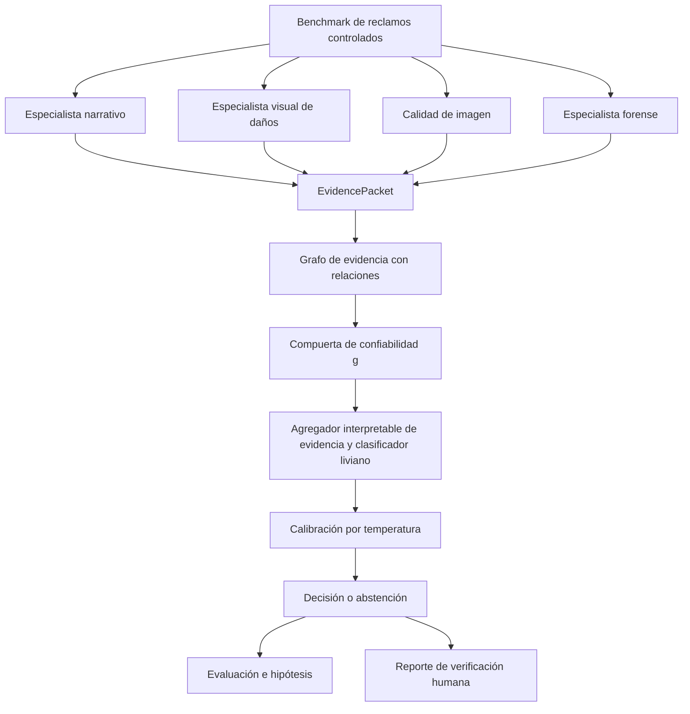
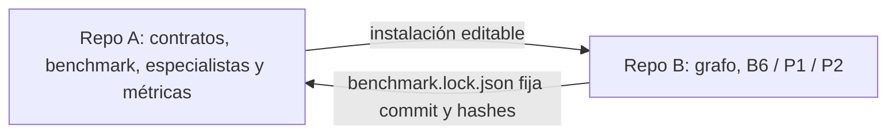

# Verificación de reclamos vehiculares: datos, especialistas y evaluación

Este repositorio es la mitad de datos de mi tesis sobre UAFEG (*Uncertainty-Aware Forensic Evidence Graph*). El problema es decidir si un reclamo de seguro vehicular, formado por un relato escrito y una fotografía del daño, queda respaldado por su evidencia. La salida es una de tres etiquetas: `SUPPORTED` si la evidencia respalda el relato, `SUSPICIOUS` si hay contradicciones o señales de manipulación, e `INSUFFICIENT` si no alcanza para decidir. Sospechoso no significa fraude demostrado: significa que el caso merece revisión humana.

Aquí viven el benchmark, los contratos de datos, los especialistas por modalidad y las métricas. Los modelos de la propuesta están en el repositorio hermano [uafeg](../uafeg/README.md), que importa de aquí los esquemas y las métricas en lugar de duplicarlos.

## Flujo completo



Cada especialista describe lo que observa y el resultado se guarda en un `EvidencePacket`. La compuerta reduce el peso de las observaciones poco confiables; el agregador (repo `uafeg`) suma apoyo, contradicción y evidencia forense ponderados por g. La capa GATv2 quedó **fuera del alcance final** (2026-11-20). La calibración y los umbrales de abstención se ajustan solo en validación.

## Cómo se reparten los dos repositorios



Repo A define una sola vez los esquemas, las etiquetas y las métricas. Repo B los importa y añade los modelos. El archivo `benchmark.lock.json` de Repo B fija el commit exacto de Repo A y el SHA-256 de 35 archivos del contrato, de modo que un cambio accidental en los datos o los esquemas se detecta antes de entrenar. Deben mantenerse como carpetas hermanas.

## El benchmark

Las imágenes vienen del dataset [Car Parts and Car Damages de Humans in the Loop](https://humansintheloop.org/resources/datasets/car-parts-and-car-damages-dataset/), con licencia declarada CC0 1.0. De las 814 imágenes anotadas con daño se aceptaron **807 fuentes** con 8.979 objetos anotados; las siete excluidas tienen polígonos degenerados o con huecos no soportados por el contrato.

Sobre cada fuente se generan escenarios controlados. **No son expedientes reales de una aseguradora.** El split se asigna por `source_image_id` antes de generar las variantes, así que todas las variantes de una imagen caen en la misma partición y ninguna fuente cruza de split.

| Condición | Qué se altera | Etiqueta |
|---|---|---|
| C0 | Nada; narrativa compatible e imagen original | SUPPORTED |
| C1 | La narrativa niega una clase de daño realmente anotada | SUSPICIOUS |
| C2 | Se sustituye la imagen por la de otro expediente del mismo split | SUSPICIOUS |
| C3 | Copy-move localizado de 24×24 fuera de las máscaras de daño | SUSPICIOUS |
| C4 | Inpainting (Telea) del polígono de daño más pequeño | SUSPICIOUS |
| C5 | C3 más una negación narrativa cuyos píxeles siguen intactos | SUSPICIOUS |
| C6 | Se elimina el relato | INSUFFICIENT |
| C7 | Se elimina la imagen | INSUFFICIENT |
| C8 | JPEG de calidad 95, redimensionado o recorte benigno | SUPPORTED |
| C9 | Desenfoque gaussiano, solo si la varianza Laplaciana cae a 1 o menos | INSUFFICIENT |
| C10 | Inversión RGB localizada, familia reservada a test | OOD |

C10 no es una cuarta clase de entrenamiento: se reserva para medir comportamiento fuera de distribución y se reporta aparte.

**v3 es la versión oficial y está congelada** (9.275 reclamos sobre las 807 fuentes; `READY_FOR_MODELS = YES`, criterios de validez C2–C5 aplicados: 552 reclamos AMBIGUOS conservados y analizados con y sin ellos). v2 (226 reclamos) queda como histórica.

Las auditorías comprueban tres cosas antes de permitir entrenar:

- **Fuga entre particiones.** Se verifica que ninguna imagen ni grupo de duplicados aparezca en dos splits. Los duplicados exactos se agrupan por dHash antes de asignar la partición. En v3 no se detectaron pares duplicados ni near-duplicates bajo el umbral fijado.
- **Atajos lingüísticos.** El generador de narrativas se corrigió para compartir plantillas, prefijos y cierres entre etiquetas, de modo que la longitud o el estilo del texto no delaten la clase. El atajo no está eliminado: C1 y C5 siguen negando daños presentes, y falta un control de ausencia compatible adjudicado.
- **Etiquetas y metadatos fuera de las features.** `expected_label`, la condición, los identificadores y las rutas se conservan solo para trazabilidad y evaluación. Nunca entran al modelo, y hay tests que lo comprueban.

Dos limitaciones honestas: muchas manipulaciones son muy pequeñas en proporción al área de la imagen, y la QA examinó también el conjunto de test para diseñar el benchmark, de modo que no puede presentarse como un conjunto confirmatorio completamente ciego.

## Componentes y métodos

| Componente | Método | Referencia | Estado (2026-11-21) |
|---|---|---|---|
| Especialista narrativo | NLI por afirmación, `MoritzLaurer/mDeBERTa-v3-base-mnli-xnli` (no se reentrena) | Laurer et al., 2022; He et al., 2021 | Ejecutado sobre los 960 relatos distintos |
| Especialista visual | YOLOv8n-seg ajustado en HITL train (val para early stopping), Kaggle GPU T4 | Jocher et al., Ultralytics, 2023 | Entrenado; inferencia sobre las 5 240 imágenes |
| Validación externa visual | CarDD (espejo Kaggle CC BY-NC 4.0, solo cajas) | Wang, Li y Wu, IEEE T-ITS 2023 | Evaluado (mAP de caja); mAP de máscara NOT_RUN |
| Especialista forense | TruFor, pesos oficiales, `weights_only=True`, resolución nativa, Kaggle GPU | Guillaro et al., CVPR 2023 | Ejecutado sobre las 5 240 imágenes |
| Calidad de imagen | resolución × nitidez Laplaciana × exposición | — | Ejecutado |
| Confiabilidad r | medida en validación por especialista (`data/specialists/reliability_v3.json`) | — | Medida |
| B8 | Qwen2-VL-2B-Instruct congelado, zero-shot, Kaggle GPU | Wang et al., 2024 | Ejecutado (val y test) |
| Comparador sin grafo | DeepSets | Zaheer et al., NeurIPS 2017 | Entrenado (repo uafeg) |
| Atención sobre el grafo | GATv2 | Brody, Alon y Yahav, ICLR 2022 | **Fuera del alcance final**: no se entrena ni evalúa |
| Calibración, abstención, bootstrap, Holm | temperature scaling; riesgo-cobertura/AURC; bootstrap agrupado; Holm | Guo et al., 2017; Geifman y El-Yaniv, 2017; Holm, 1979 | Aplicados en la evaluación final (repo uafeg) |

<!-- SPECIALISTS:BEGIN -->
### Especialistas medidos (archivos reales)

| Especialista | Métrica | Valor |
|---|---|---|
| Narrativo | tipo de daño exacto / por familia / polaridad (val, n=1129) | 0.500 / 0.689 / 0.965 |
| Visual YOLOv8n-seg | máscara mAP50 / mAP50-95, val HITL (110 img) | 0.118 / 0.055 |
| | caja mAP50 / mAP50-95, val HITL (110 img) | 0.128 / 0.071 |
| Visual YOLOv8n-seg | máscara mAP50 / mAP50-95, test HITL (129 img) | 0.096 / 0.041 |
| | caja mAP50 / mAP50-95, test HITL (129 img) | 0.112 / 0.056 |
| | CarDD test (374 img), caja, clases mapeadas | 0.054 / 0.022 |
| | CarDD test, caja, daño agnóstico | 0.077 / 0.030 |
| | CarDD máscara | NOT_RUN (el espejo con licencia declarada solo trae cajas) |
| Forense TruFor | AUROC C3 vs C0 (val, imágenes) | 0.889 |
| Forense TruFor | AUROC C4 vs C0 (val, imágenes) | 0.544 |
| Forense TruFor | AUROC C5 vs C0 (val, imágenes) | 0.889 |
| | AUROC C3–C5 vs C0 (val) | 0.774 |

<!-- SPECIALISTS:END -->

Los scripts de los kernels de Kaggle están en `scripts/kaggle/` (las credenciales nunca se guardan;
se leen de la variable de entorno `KAGGLE_API_TOKEN`). Los datos externos y las licencias de los
modelos están registrados en [data/EXTERNAL_DATA.md](data/EXTERNAL_DATA.md).

## Resultados

Las cifras finales de la tesis se calcularon en el repositorio `uafeg` (test evaluado una sola vez); estas figuras
viven en `uafeg/presentacion/figuras/` (este repo no guarda imágenes, por su test de higiene), donde están también en SVG con su explicación (`LEEME.md`).


En pocas palabras:
- **UAFEG (G1) no supera a la fusión tardía calibrada B5**: PR-AUC de Suspicious 0.851 frente a 0.878, H1
  rechazada.
- **La compuerta no mejora la calibración**: H2 rechazada.
- **El forense sí aporta**: H3 aceptada, +0.062.
- **El especialista visual es el más débil de los tres.** Aun así, un análisis post hoc en `uafeg` muestra que
  mejorar solo la parte visual no cierra la brecha.

## Aportes de este repositorio

- **Benchmark v3 congelado**: 9 275 reclamos sobre 807 fotos reales, con 11 condiciones controladas, split por
  fuente sin fugas e imágenes verificadas por SHA-256.
- **Contratos de datos** (`EvidencePacket`) que comparten todos los sistemas, más métricas y estadística comunes.
- **Especialistas reales y medidos**:
  - narrativo: NLI por afirmación;
  - visual: YOLOv8n-seg en Kaggle GPU, con validación externa en CarDD;
  - forense: TruFor;
  - calidad de imagen;
  - confiabilidad r medida en validación.

## Limitaciones honestas

- Los reclamos son escenarios controlados sobre imágenes reales, no expedientes de una aseguradora.
- El especialista visual es débil (mAP de máscara bajo en HITL y mAP de caja aún más bajo en CarDD; ver tabla): 807 fuentes, 8 clases y un modelo nano.
- C3 y C5 comparten exactamente las mismas imágenes editadas; C3 y casi todo C4 modifican menos del 0.5 % del área.
- El test no es completamente ciego: se miró al diseñar la QA del benchmark.
- Narrativo: el tipo de daño exacto acierta la mitad de las veces; se usa la familia de la ontología para medir r.
- TruFor casi no distingue el inpainting de daño (AUROC 0.544 en C4), y no se reentrena.

## Cómo reproducir

```bash
python3.11 -m venv .venv
.venv/bin/python -m pip install -r requirements.txt
.venv/bin/python -m pip install --no-deps -e .
```

Pruebas, comprobación del benchmark sin regenerarlo, y demo:

```bash
env -u PYTHONPATH OMP_NUM_THREADS=1 MKL_NUM_THREADS=1 .venv/bin/python -m pytest -q
env -u PYTHONPATH .venv/bin/python scripts/build_benchmark_v3.py --check --verify-images
./run_demo.sh
```

Los scripts de auditoría escriben en `reports/`, que está fuera de git porque su contenido se regenera. Las mediciones que otros componentes leen viven en `data/qa/`. El segundo comando necesita las imágenes descargadas y no resuelve ninguna ambigüedad científica: superar una verificación estructural no cambia `READY_FOR_MODELS`.

## Organización

| Ruta | Contenido |
|---|---|
| `src/schemas/` | `ClaimRecord`, `EvidencePacket` y tipos de evidencia |
| `src/data/` | Ingesta, manifests, particiones, generación de versiones y QA |
| `src/narrative/`, `src/damage/`, `src/forensic/` | Especialistas por modalidad |
| `src/fusion/` | Características y reglas del baseline B0 |
| `src/evaluation/`, `src/calibration/`, `src/uncertainty/`, `src/abstention/` | Métricas, probabilidades y decisión selectiva |
| `configs/` | Etiquetas, condiciones y versiones del benchmark |
| `data/` | Manifests versionados y mediciones de QA |
| `scripts/` | Descarga, construcción y auditoría |
| `demo/` | Demo local del benchmark |
| `tests/` | Pruebas de contrato, datos y controles anti-fuga |

### Scripts

| Script | Para qué |
|---|---|
| `fetch_hitl_pilot.py`, `prepare_hitl_pilot.py`, `fetch_hitl_full.py` | Descarga y preparación de las fotos HITL (con recibos SHA-256 en `data/`) |
| `build_claim_benchmark.py`, `build_benchmark_v2.py`, `build_benchmark_v3.py` | Construcción de las versiones del benchmark (v3 es la oficial) |
| `apply_v3_validity_criteria.py`, `check_splits.py` | Criterios de validez C2–C5 y control de fugas entre particiones |
| `audit_benchmark_v2.py`, `audit_benchmark_v3_pixels.py`, `summarize_benchmark_qa.py`, `build_review_sample.py` | QA medida (salida en `reports/` y `data/qa/`) y muestra para revisión humana del benchmark |
| `prepare_damage_specialist_data.py`, `train_damage_specialist.py` | Datos y entrenamiento local del especialista visual (el final se entrenó en Kaggle) |
| `run_specialists.py`, `build_evidence_packets.py` | Especialistas, confiabilidad r y `EvidencePacket` |
| `create_demo_variants.py` | Variantes de la demo |
| `kaggle/` | Kernels de Kaggle (YOLO v1/v2 y yolo11m post hoc, inferencia visual, TruFor, B8) y empaquetado de datos (`stage_code.py`, `stage_variants.py`) |

Los protocolos que fijan reglas y no se regeneran están en la raíz: [el contrato experimental](EXPERIMENTAL_PROTOCOL.md), [el diseño estadístico](STATISTICAL_EVALUATION_PROTOCOL.md) y los protocolos de construcción del benchmark ([general](BENCHMARK_PROTOCOL.md) y [v2](BENCHMARK_V2_PROTOCOL.md)).
