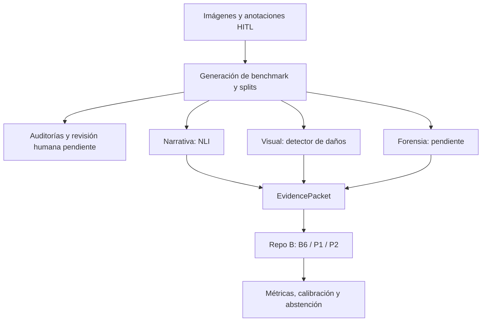

# Datos, especialistas y evaluación de reclamos

Repo A del proyecto [UAFEG](../README.md). Proporciona el contrato común que usa el [Repo B de modelos](../uafeg/README.md).

**Benchmark v3 construido, pendiente de validación científica. Sin resultados predictivos finales.** Hay 807 imágenes fuente aceptadas, 8.979 objetos anotados y 9.275 escenarios controlados. Los escenarios no son expedientes reales de una aseguradora.

## Flujo y responsabilidades



El diagrama muestra el flujo previsto completo; el detector visual carece de checkpoint local y el especialista forense no está implementado. Los EvidencePacket congelados de v2 tienen especialistas en null.

## Qué hay en cada carpeta

| Ruta | Responsabilidad |
|---|---|
| `src/schemas/` | ClaimRecord, EvidencePacket y tipos de evidencia; contrato único. |
| `src/data/` | Ingesta HITL, manifest, particiones, generación v1/v2/v3 y QA. |
| `src/narrative/` | Extracción narrativa mediante NLI. |
| `src/damage/` | Preparación YOLO, entrenamiento e inferencia visual. |
| `src/forensic/image_quality.py` | Calidad de imagen. No detecta manipulación forense. |
| `src/fusion/` | Características y reglas B0; orquestación narrativa/visual. |
| `src/evaluation/` | Métricas, condiciones de estrés y estadística agrupada. |
| `src/calibration/`, `src/uncertainty/`, `src/abstention/` | Probabilidades, incertidumbre y derivación a revisión. |
| `configs/` | Etiquetas, reglas y condiciones/versiones del benchmark. |
| `data/` | Recibos y manifests versionados; raw/procesados locales. |
| `scripts/` | Descarga, construcción y auditoría; inventario abajo. |
| `tests/` | Pruebas unitarias e integración opcional con modelos. |
| `demo/` | Demo Streamlit B0 y dashboard del benchmark. |
| `docs/qa/` | Informe científico de QA. |
| `*_AUDIT*.md`, `qa_*.json`, galerías HTML | Evidencia generada de auditoría; se conserva para trazabilidad. |

## Instalación y pruebas

Desde esta carpeta:

```bash
python3.11 -m venv .venv
.venv/bin/python -m pip install -r requirements.txt
.venv/bin/python -m pip install --no-deps -e .
env -u PYTHONPATH OMP_NUM_THREADS=1 MKL_NUM_THREADS=1 .venv/bin/python -m pytest -q
```

Las pruebas con modelos se omiten por defecto; requieren pesos cacheados y `--run-model-tests`. Los tests no deben descargar modelos ni iniciar entrenamiento.

## Inventario de scripts

| Script | Uso |
|---|---|
| `fetch_hitl_full.py` | Adquirir imágenes/anotaciones completas; requiere red. |
| `build_benchmark_v3.py` | Construir o comprobar el candidato actual v3. Usar `--check --verify-images` para comprobar imágenes existentes. |
| `audit_benchmark_v3_pixels.py` | Verificar manipulaciones y generar auditorías; requiere imágenes locales. |
| `summarize_benchmark_qa.py` | Regenerar resumen de QA v2/v3; requiere artefactos correspondientes. |
| `check_splits.py` | Detectar cruces entre particiones. |
| `fetch_hitl_pilot.py`, `prepare_hitl_pilot.py` | Reproducir el piloto histórico, aún utilizado por pruebas/versiones congeladas. |
| `build_claim_benchmark.py`, `build_benchmark_v2.py` | Reproducir/verificar v1/v2; se conservan porque el lock del Repo B referencia estos datos. |
| `audit_benchmark_v2.py` | Auditar la versión congelada. |
| `create_demo_variants.py` | Crear recursos visuales de demostración; no entrena modelos. |
| `build_review_sample.py` | Generar `benchmark_v3_review_sample.html`: muestra determinista para revisión humana de C2–C5 con criterios propuestos; reutiliza auditorías ya calculadas, no recomputa sobre imágenes. |
| `prepare_damage_specialist_data.py` | Construir el manifest fuente (807 imágenes) con el split congelado del benchmark y verificar la conversión a YOLO-seg en un subconjunto pequeño; no copia el dataset completo ni entrena. |

No ejecutar todos los scripts como una secuencia de entrenamiento: varios escriben reportes o regeneran datos. Los scripts históricos conservados tienen una función de reproducción, no están abandonados por ser antiguos.

## Documentación y reglas

- [Guía técnica](docs/TECHNICAL_GUIDE.md): comandos de comprobación y estado de componentes.
- [Protocolo experimental](EXPERIMENTAL_PROTOCOL.md): contrato congelado que verifica el lock; no modificar sin revisión.
- [Protocolo estadístico](STATISTICAL_EVALUATION_PROTOCOL.md): agrupación y análisis.
- [QA pendiente](docs/qa/FINAL_BENCHMARK_QA_REPORT.md): problemas que bloquean la promoción.
- [Datos](data/README.md): versiones y procedencia.
- [Preparación del entrenamiento](../uafeg/docs/TRAINING.md): única secuencia de próximos pasos.

Repo A no implementa B6/P1/P2. La calidad de imagen no sustituye al especialista forense. Las anotaciones fuente se usan para construir/auditar escenarios y para controles explícitos con evidencia de referencia; no deben presentarse como predicciones de especialistas. Las variantes de una fuente permanecen en el mismo split; C10 se reserva para estrés en test.

## Demo

```bash
./run_demo.sh
```

Abre el dashboard local del benchmark. [Detalles](demo/benchmark/README.md). Una visualización de etiquetas o una corrida de reglas no es una predicción de P2 entrenado.
