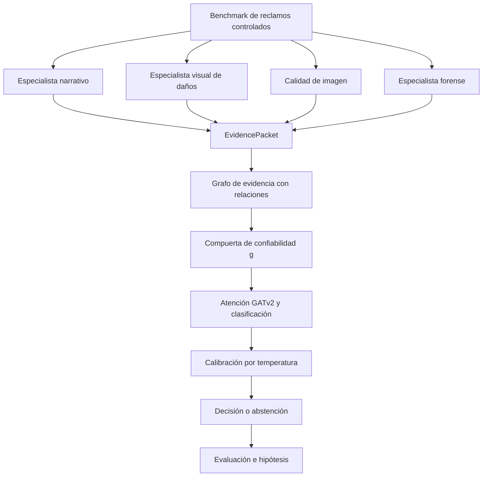
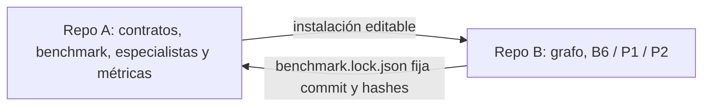

# Verificación de reclamos vehiculares: datos, especialistas y evaluación

Este repositorio es la mitad de datos de mi tesis sobre UAFEG (*Uncertainty-Aware Forensic Evidence Graph*). El problema es decidir si un reclamo de seguro vehicular, formado por un relato escrito y una fotografía del daño, queda respaldado por su evidencia. La salida es una de tres etiquetas: `SUPPORTED` si la evidencia respalda el relato, `SUSPICIOUS` si hay contradicciones o señales de manipulación, e `INSUFFICIENT` si no alcanza para decidir. Sospechoso no significa fraude demostrado: significa que el caso merece revisión humana.

Aquí viven el benchmark, los contratos de datos, los especialistas por modalidad y las métricas. Los modelos de la propuesta están en el repositorio hermano [uafeg](../uafeg/README.md), que importa de aquí los esquemas y las métricas en lugar de duplicarlos.

## Flujo completo



Cada especialista describe lo que observa y el resultado se guarda en un `EvidencePacket`. La compuerta reduce el peso de las observaciones poco confiables antes de que el grafo propague mensajes. La calibración y los umbrales de abstención se ajustan solo en validación.

## Cómo se reparten los dos repositorios



Repo A define una sola vez los esquemas, las etiquetas y las métricas. Repo B los importa y añade los modelos. El archivo `benchmark.lock.json` de Repo B fija el commit exacto de Repo A y el SHA-256 de 35 archivos del contrato, de modo que un cambio accidental en los datos o los esquemas se detecta antes de entrenar. Deben mantenerse como carpetas hermanas.

## El benchmark

Las imágenes vienen del dataset [Car Parts and Car Damages de Humans in the Loop](https://humansintheloop.org/resources/datasets/car-parts-and-car-damages-dataset/), con licencia declarada CC0 1.0. De las 814 imágenes anotadas con daño se aceptaron **807 fuentes** con 8.979 objetos anotados; las siete excluidas tienen polígonos degenerados o con huecos no soportados por el contrato.

Sobre cada fuente se generan escenarios controlados. **No son expedientes reales de una aseguradora.** El split se asigna por `source_image_id` antes de generar las variantes, así que todas las variantes de una imagen caen en la misma partición y ninguna fuente cruza de split.

| Condición | Qué se altera | Etiqueta |
|---|---|---|
| C0 | Nada; narrativa compatible e imagen original | SUPPORTED |
| C1 | La narrativa niega una clase de daño realmente anotada | SUSPICIOUS |
| C2 | Se sustituye la imagen por la de otro expediente del mismo split | SUSPICIOUS |
| C3 | Copy-move localizado de 24×24 fuera de las máscaras de daño | SUSPICIOUS |
| C4 | Inpainting (Telea) del polígono de daño más pequeño | SUSPICIOUS |
| C5 | C3 más una negación narrativa cuyos píxeles siguen intactos | SUSPICIOUS |
| C6 | Se elimina el relato | INSUFFICIENT |
| C7 | Se elimina la imagen | INSUFFICIENT |
| C8 | JPEG de calidad 95, redimensionado o recorte benigno | SUPPORTED |
| C9 | Desenfoque gaussiano, solo si la varianza Laplaciana cae a 1 o menos | INSUFFICIENT |
| C10 | Inversión RGB localizada, familia reservada a test | OOD |

C10 no es una cuarta clase de entrenamiento: se reserva para medir comportamiento fuera de distribución y se reporta aparte.

Hay dos versiones. **v2 está congelada** (226 reclamos sobre 24 fuentes) y es la que fija el lock. **v3 es candidata** (9.275 reclamos sobre las 807 fuentes) y sigue pendiente de validación: `READY_FOR_MODELS = NO`.

Las auditorías comprueban tres cosas antes de permitir entrenar:

- **Fuga entre particiones.** Se verifica que ninguna imagen ni grupo de duplicados aparezca en dos splits. Los duplicados exactos se agrupan por dHash antes de asignar la partición. En v3 no se detectaron pares duplicados ni near-duplicates bajo el umbral fijado.
- **Atajos lingüísticos.** El generador de narrativas se corrigió para compartir plantillas, prefijos y cierres entre etiquetas, de modo que la longitud o el estilo del texto no delaten la clase. El atajo no está eliminado: C1 y C5 siguen negando daños presentes, y falta un control de ausencia compatible adjudicado.
- **Etiquetas y metadatos fuera de las features.** `expected_label`, la condición, los identificadores y las rutas se conservan solo para trazabilidad y evaluación. Nunca entran al modelo, y hay tests que lo comprueban.

Dos limitaciones honestas: muchas manipulaciones son muy pequeñas en proporción al área de la imagen, y la QA examinó también el conjunto de test para diseñar el benchmark, de modo que no puede presentarse como un conjunto confirmatorio completamente ciego.

## Componentes y métodos

| Componente | Método | Referencia | Estado |
|---|---|---|---|
| Especialista narrativo | Inferencia textual (NLI) multilingüe sobre el relato | sin cita en el `.tex` | Implementado |
| Especialista visual | Segmentación de daño con YOLO-seg | sin cita en el `.tex` | Implementado, sin checkpoint entrenado |
| Dataset de referencia para daño vehicular | CarDD | Wang, Li y Wu, *CarDD: A New Dataset for Vision-Based Car Damage Detection*, IEEE T-ITS 24(7):7202–7214, 2023 | Referencia de diseño |
| Fuente de imágenes usada | Car Parts and Car Damages | Humans in the Loop, 2026, CC0 1.0 | En uso |
| Especialista forense | TruFor (localización y score de manipulación) | Guillaro, Cozzolino, Sud, Dufour y Verdoliva, CVPR 2023, pp. 20606–20615 | Pendiente de implementar |
| Calidad de imagen | Varianza Laplaciana y comprobación de corrupción | — | Implementado. No detecta manipulación |
| Comparador sin grafo | DeepSets | Zaheer, Kottur, Ravanbakhsh, Poczos, Salakhutdinov y Smola, NeurIPS 30, 2017 | Implementado, sin entrenar |
| Atención sobre el grafo | GATv2 | Brody, Alon y Yahav, *How Attentive are Graph Attention Networks?*, ICLR 2022 | Implementado, sin entrenar |
| Fusión multimodal con incertidumbre | Discounted Belief Fusion | Bezirganyan, Sellami, Berti-Equille y Fournier, AISTATS 2025, PMLR 258:3142–3150 | Referencia de diseño de la compuerta |
| Calibración | Temperature scaling | Guo, Pleiss, Sun y Weinberger, ICML 2017, PMLR 70:1321–1330 | Implementado, no aplicado a datos reales |
| Abstención | Clasificación selectiva, riesgo-cobertura y AURC | Geifman y El-Yaniv, NeurIPS 30, 2017, pp. 4878–4887 | Implementado, no aplicado a datos reales |
| Intervalos de confianza | Bootstrap agrupado por `source_image_id`, 2.000 a 5.000 réplicas | descrito en el `.tex`, sin cita bibliográfica | Implementado, no ejecutado |
| Comparaciones múltiples | Corrección de Holm, α global de 0,05 sobre H1, H2 y H3 | descrito en el `.tex`, sin cita bibliográfica | Implementado, no ejecutado |

Las referencias salen del archivo `referencias.bib` de la tesis. Donde el `.tex` no tiene cita, la columna lo dice en vez de atribuir una fuente que no elegí.

## Estado actual

| Área | Estado |
|---|---|
| Contratos, esquemas y organización | Hecho |
| Benchmark v2 congelado y verificado | Hecho |
| Benchmark v3 generado y auditado | Hecho, pendiente de adjudicación humana |
| Auditorías de fuga, duplicados y atajos | Hechas |
| Especialista narrativo | Implementado, falta ejecutarlo sobre los relatos definitivos |
| Especialista visual | Datos y manifest listos (807 fuentes, split congelado), falta el checkpoint |
| Especialista forense | Pendiente por completo |
| Métricas, calibración, incertidumbre y abstención | Implementadas, nunca aplicadas a predicciones reales |
| Entrenamiento y resultados | No existen. Nada se ha entrenado sobre el benchmark |

Las suites de pruebas pasan con 158 casos y 5 omitidos. Las omitidas requieren pesos de modelo cacheados y se activan con `--run-model-tests`.

## Qué falta, en orden

1. Que mi asesora decida los criterios de validez de C2, C3, C4 y C5 sobre la muestra de revisión, y la taxonomía de nodos del grafo.
2. Entrenar y seleccionar el checkpoint de YOLO-seg para el especialista visual.
3. Implementar el adaptador de TruFor para el especialista forense.
4. Implementar el cargador real con controles anti-fuga, y con él la ablación A5.
5. Generar los `EvidencePacket` por partición con predicciones y procedencia reales.
6. Aprobar y congelar una versión del benchmark, y actualizar el lock deliberadamente.
7. Entrenar B6, P1 y P2 con las semillas acordadas.
8. Calibrar en validación, evaluar en test una sola vez y contrastar H1, H2 y H3.

## Cómo correrlo

```bash
python3.11 -m venv .venv
.venv/bin/python -m pip install -r requirements.txt
.venv/bin/python -m pip install --no-deps -e .
```

Pruebas, comprobación del benchmark sin regenerarlo, y demo:

```bash
env -u PYTHONPATH OMP_NUM_THREADS=1 MKL_NUM_THREADS=1 .venv/bin/python -m pytest -q
env -u PYTHONPATH .venv/bin/python scripts/build_benchmark_v3.py --check --verify-images
./run_demo.sh
```

Los scripts de auditoría escriben en `reports/`, que está fuera de git porque su contenido se regenera. Las mediciones que otros componentes leen viven en `data/qa/`. El segundo comando necesita las imágenes descargadas y no resuelve ninguna ambigüedad científica: superar una verificación estructural no cambia `READY_FOR_MODELS`.

## Organización

| Ruta | Contenido |
|---|---|
| `src/schemas/` | `ClaimRecord`, `EvidencePacket` y tipos de evidencia |
| `src/data/` | Ingesta, manifests, particiones, generación de versiones y QA |
| `src/narrative/`, `src/damage/`, `src/forensic/` | Especialistas por modalidad |
| `src/fusion/` | Características y reglas del baseline B0 |
| `src/evaluation/`, `src/calibration/`, `src/uncertainty/`, `src/abstention/` | Métricas, probabilidades y decisión selectiva |
| `configs/` | Etiquetas, condiciones y versiones del benchmark |
| `data/` | Manifests versionados y mediciones de QA |
| `scripts/` | Descarga, construcción y auditoría |
| `demo/` | Demo local del benchmark |
| `tests/` | Pruebas de contrato, datos y controles anti-fuga |

Los protocolos que fijan reglas y no se regeneran están en la raíz: [el contrato experimental](EXPERIMENTAL_PROTOCOL.md), [el diseño estadístico](STATISTICAL_EVALUATION_PROTOCOL.md) y los protocolos de construcción del benchmark ([general](BENCHMARK_PROTOCOL.md) y [v2](BENCHMARK_V2_PROTOCOL.md)).
